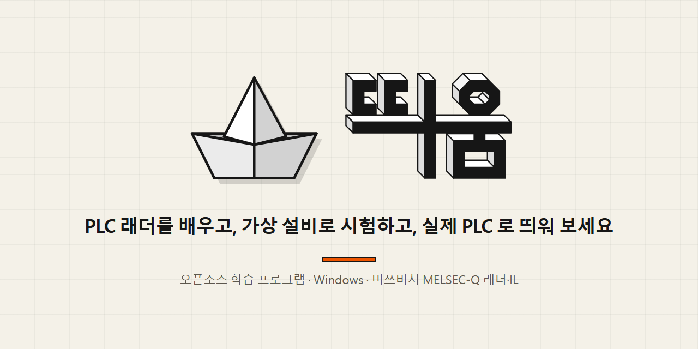
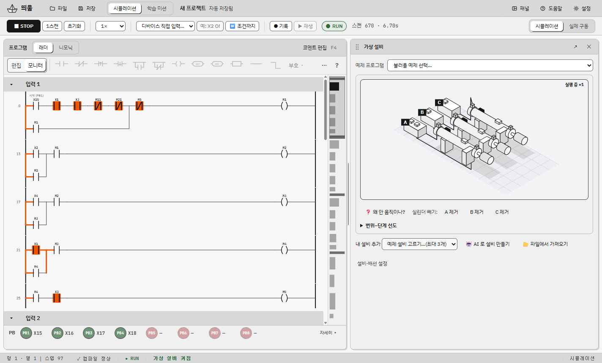
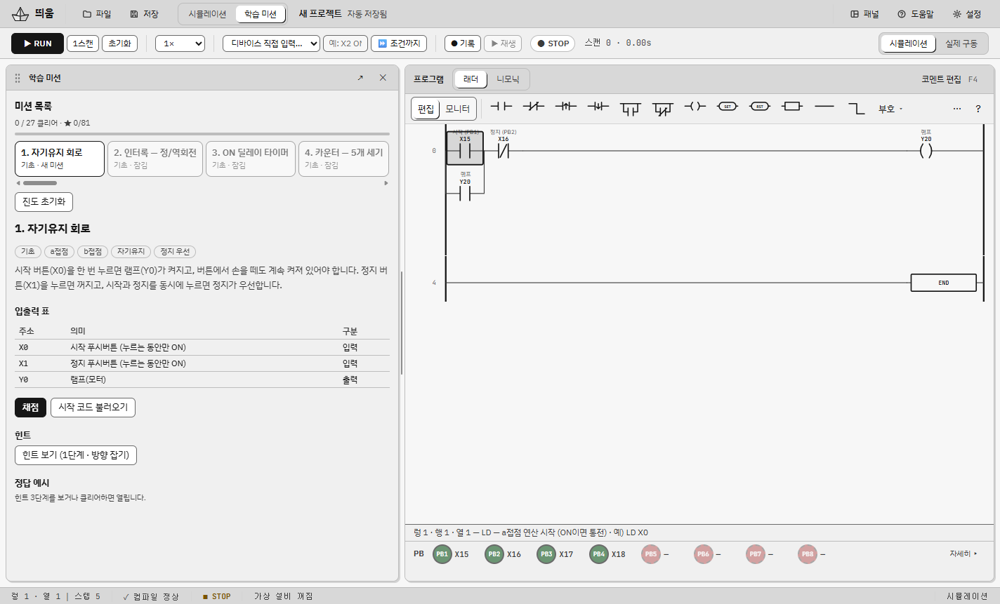
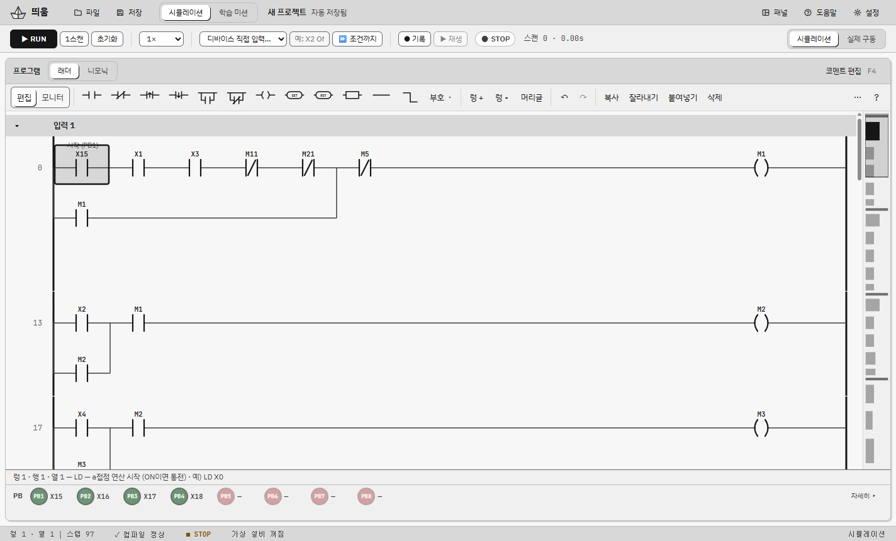
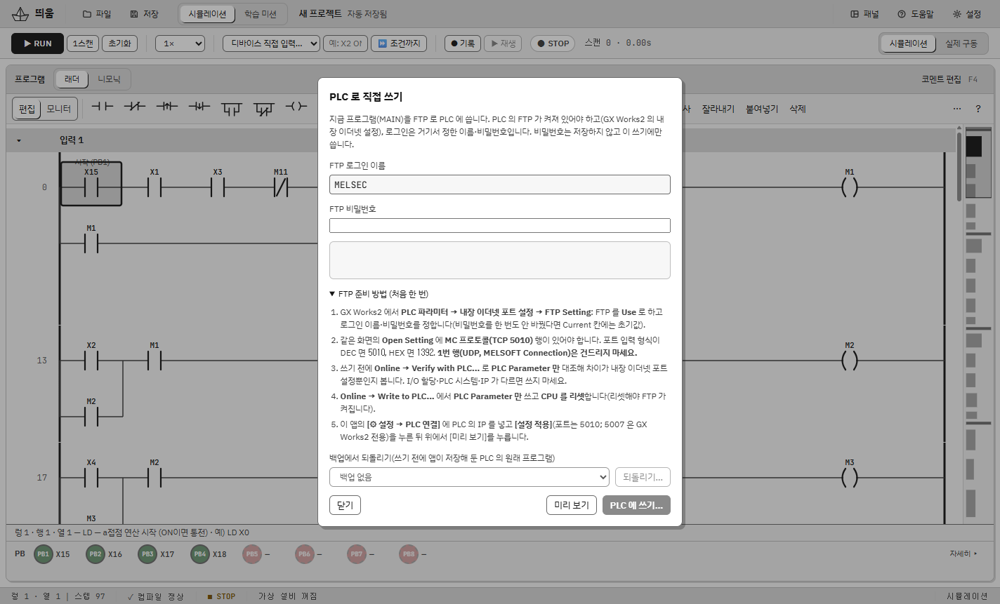
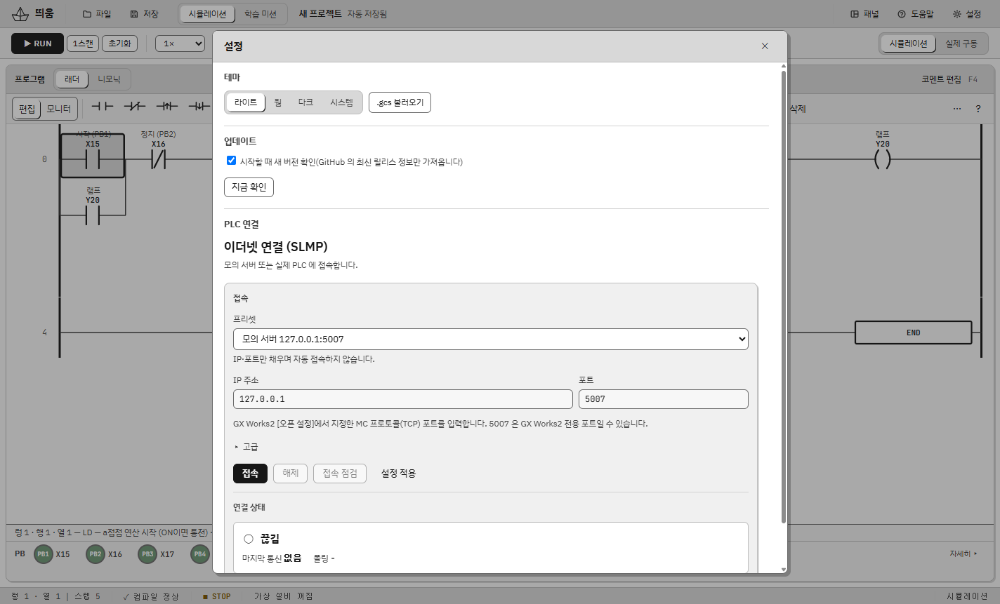

  

<h3 align="center">PLC 래더를 배우고, 가상 설비로 시험하고, 실제 PLC 로 띄워 보세요.</h3>

  래더 편집기 · 가상 실린더 설비 · 학습 미션 · 실제 PLC 연결을 한국어 화면 하나에 모았어요. 
  미쓰비시 <b>MELSEC-Q</b> 래더·IL 을 연습하는 <b>오픈소스</b> Windows 앱이에요.

  
  
  
  

  <a href="https://github.com/Dawnilove/Ddium/releases/latest/download/Ddium-Setup.exe"><b>⬇ 설치 파일 바로 받기 (Ddium-Setup.exe)</b></a>
  &nbsp;·&nbsp;
  <a href="https://github.com/Dawnilove/Ddium/releases/latest/download/Ddium-portable.exe">설치 없이 쓰는 휴대용</a>

> 이 프로젝트는 미쓰비시전기와 관련이 없어요. MELSEC·GX Works2·MELSOFT 는 미쓰비시전기의 상표이며, 호환 형식과 통신 규격을 설명하려고 이름만 써요.

## ✨ 주요 기능

- 🪜 **래더 편집기** — 접점·코일·타이머·카운터·비교·산술·32비트 명령을 그리고 니모닉(IL)과 오가요. GX Works2 방식의 "놓고 선으로 잇기"와 단축키, 가로선·세로선, 끌어 놓기, 미니맵, 되돌리기, 코멘트, 찾기·교차 참조
- 🏭 **가상 설비** — 실린더 A·B·C 등각 도면. 래더의 접점·코일과 그림의 센서·솔레노이드가 서로 강조되고, 변위–단계 선도·압력 그래프·"왜 안 움직이나?" 진단이 있어요. 내 설비를 JSON(또는 격리 실행되는 JavaScript)으로 만들 수도 있어요
- 🎯 **학습 미션 39개** — 자동 채점, 힌트 3단계, 채점 결과를 그림 위에 보여 주는 덮개, 일부러 틀린 프로그램을 고치는 오류 찾기
- 🧑‍🏫 **학습 모드(플러그인)** — 내 래더를 렁 단위로 나눠 한 단계씩 설명하고, [해 보기]로 센서 신호를 자동으로 넣어 켜지고 꺼지는 것을 확인해요. 모르는 것은 질문칸에 물어보면 돼요(AI 를 연결하면 더 자세히)
- 🧩 **플러그인** — 필요한 기능을 골라 받아요(PLC 점검 도구·사진 장면 초안·순서 생성기·학습 모드). 플러그인은 격리돼 실행되고 허용한 권한만 써요
- 📜 **ST·SFC** — 래더·IL 과 함께 ST(구조적 텍스트)와 SFC(순차 기능 차트) 화면을 지원해요. 영문 화면도 있어요
- 📈 **타이밍 차트** — 신호의 ON/OFF 변화를 시간순으로 보고 CSV·PNG 로 내보내요
- 🤖 **AI 도우미** — 설치된 Claude Code 같은 CLI 에 말로 프로그램을 만들어 달라고 하고 [적용]/[되돌리기]
- 🔁 **GX Works2 호환** — 목록 형식 CSV 가져오기·내보내기, `.gxw` 열기
- 🔌 **실제 PLC** — SLMP 로 읽기(기본 읽기 전용), 실제 구동 모드, 그리고 FTP 로 프로그램을 PLC 에 **직접 쓰기**(승인 창·쓰기 전 자동 백업·되읽기 비교·백업에서 되돌리기)
- 🆕 **앱 안 업데이트** — 새 버전이 나오면 알려 주고 [업데이트] 한 번으로 받아 설치해요(SHA-256 확인)
- 🌐 **웹 방식(실험)** — 서명 없는 exe 가 막히는 PC 용: 공식 Node.js 와 Edge 앱 창으로 같은 화면을 열어요

  

<table>
  <tr>
    <td width="50%"> <b>학습 미션</b> · 문제를 읽고 래더를 그려 채점해요</td>
    <td width="50%"> <b>래더 편집</b> · 접점·코일을 그리고 IL 과 오가요</td>
  </tr>
  <tr>
    <td width="50%"> <b>PLC 로 직접 쓰기</b> · FTP 준비 방법까지 안내해요</td>
    <td width="50%"> <b>설정</b> · 테마 · 업데이트 · PLC 연결</td>
  </tr>
</table>

더 자세한 소개는 **[사이트](https://dawnilove.github.io/Ddium/)** 에서 볼 수 있어요.

## ⬇ 다운로드

아래를 누르면 바로 내려받아져요.

| 파일 | 설명 |
|---|---|
| **[⬇ Ddium-Setup.exe](https://github.com/Dawnilove/Ddium/releases/latest/download/Ddium-Setup.exe)** | 설치형 — 사용자 폴더에 설치돼요(관리자 권한 필요 없음) |
| [⬇ Ddium-portable.exe](https://github.com/Dawnilove/Ddium/releases/latest/download/Ddium-portable.exe) | 설치 없이 바로 실행 |
| [⬇ Ddium-Web.zip](https://github.com/Dawnilove/Ddium/releases/latest/download/Ddium-Web.zip) | 웹 방식(실험) — 폴더째 풀어 `Ddium-Web.cmd` 실행 |
| [SHA256SUMS.txt](https://github.com/Dawnilove/Ddium/releases/latest/download/SHA256SUMS.txt) | 받은 파일이 맞는지 확인하는 체크섬 |

다른 버전은 [Releases](https://github.com/Dawnilove/Ddium/releases) 에서 받을 수 있어요.

- **Windows 10 / 11** — "PC 보호" 창이 뜨면 **추가 정보 → 실행**을 눌러 주세요. 이 프로그램은 코드 서명이 없어서 경고가 떠요. 스마트 앱 컨트롤이 켜진 PC 에서는 실행이 막힐 수 있어요 → 웹 방식을 써 보세요.
- **업데이트** — 앱이 시작할 때(설정에서 끌 수 있음)와 [도움말 → 업데이트 확인…]에서 새 버전을 확인해요. 이 기능은 1.0.1 부터 들어 있어요. 1.0.0 을 쓰고 있다면 최신 버전을 한 번 직접 설치해 주세요

사용법은 [docs/USER-GUIDE.md](docs/USER-GUIDE.md), 변경 내역은 [CHANGELOG.md](CHANGELOG.md) 에 있어요.

## ⚠️ 실제 장비 사용 시 주의

- 이 앱은 **교육용**이에요. 실제 설비에 연결하기 전에 에어·구동부 주변을 확인하고, **하드웨어 비상 정지**를 따로 갖추세요.
- 실제 PLC 연결은 기본으로 **읽기 전용**이고, 쓰기는 사용자가 단계별로 승인해야 해요.
- "PLC 로 직접 쓰기"는 PLC 의 프로그램 파일을 바꿔요. 쓰기 전에 앱이 원본을 백업하지만, **실습용 PLC 에서 먼저** 시험하고 GX Works2 로 복구할 수 있게 원본 프로젝트를 보관하세요. 사용 결과에 대한 책임은 사용자에게 있어요.
- 지원하는 PLC 는 미쓰비시 **Q03UDV**(내장 이더넷 포트)로 확인했어요.

## 🐞 문제가 있나요?

[Issues](https://github.com/Dawnilove/Ddium/issues)에 증상과 앱 버전(도움말 → 진단 정보 복사)을 적어 주세요.

## 📄 라이선스와 출처

띄움은 [Apache License 2.0](LICENSE) 이에요(Copyright 2026 Dawnilove). `MAIN.QPG` 형식 조사와 쓰기 순서는 [plc-mcp](https://github.com/BlackBuddle/plc-mcp)(Apache-2.0)의 연구를 참고해 새로 구현했어요. 전체 고지는 [THIRD-PARTY-NOTICES.md](THIRD-PARTY-NOTICES.md) 와 [NOTICE](NOTICE) 에 있어요.
